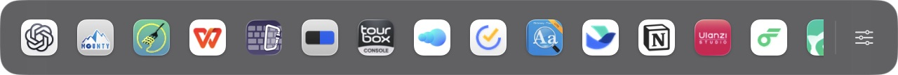

# NotchShelf · 折叠栏

[简体中文](README.md) · **English**

[Download beta](https://github.com/eugenelo233-commits/NotchShelf/releases/tag/v0.4.0) · [Report an issue](https://github.com/eugenelo233-commits/NotchShelf/issues) · [Changelog](CHANGELOG.md)

A compact, native menu bar organizer for MacBooks with a notch. Collect less-used icons in a horizontal shelf and open their original menus when you need them.

**v0.4.0 is an early public beta.** It is not Developer ID signed or notarized by Apple.

## What it does

- **Drag to collect:** hold Command and drag a third-party menu bar icon onto the double-chevron entry.
- **Click to use:** open the shelf and access the app’s original menu.
- **Drag to reorder:** hold Command inside the open shelf and drag an icon; the order is saved on drop.
- **Bring icons back:** Command-drag from the shelf to the top drop zone, or right-click an icon and choose Restore to Menu Bar.
- **Choose how to drag:** Command is required by default; an optional setting allows dragging with just the mouse.
- **Choose an appearance:** adaptive monochrome icons by default, or colorful application icons.
- **Make it yours:** choose persistent or collected icons and adjust spacing.
- **Stay local:** Swift, AppKit and SwiftUI. No account, telemetry, uploads or external package dependencies.



*Colorful app-icon mode shown in a v0.3.0 screenshot. v0.4.0 defaults to adaptive monochrome icons; color mode remains available in Settings.*

## Download and install

Download `NotchShelf-0.4.0-macOS-arm64.zip` from [Releases](https://github.com/eugenelo233-commits/NotchShelf/releases/tag/v0.4.0). Extract it, move `折叠栏.app` to Applications, and open it.

- The supplied binary is for **Apple Silicon (M-series) Macs**.
- The deployment target is macOS 14; the current hardware test environment is macOS 26.4. Other versions still need testing.
- This is a menu bar app with no Dock icon. Open the app again to access Settings.
- The binary is ad-hoc signed, without Developer ID signing or notarization. macOS may block its first launch. Verify the source and SHA-256 checksum, or build it yourself. See [Apple’s official guidance](https://support.apple.com/en-us/102445) for an explanation of system alerts.

## Usage

1. Enable **折叠栏** under System Settings → Privacy & Security → Accessibility.
2. Hold **Command (⌘)** and drag a third-party menu bar icon onto the double-chevron entry.
3. When the collect hint appears, release the mouse button and Command. The app collects the icon and opens the shelf.
4. **Hold Command and drag icons inside the open shelf to reorder them.** Drop on the left or right side of another icon to insert before or after it. The order is saved and retained when reopening the shelf. Drag near an edge to scroll; Escape or dropping outside a valid drop zone cancels. Settings also provides group selection, ordering and spacing.
5. **Restore icons to the menu bar:** Command-drag an icon from the shelf to the top restore drop zone, then release the mouse and Command. Alternatively, right-click the icon and choose **恢复到菜单栏** (Restore to Menu Bar). The other option requests the original app’s right-click action; the app determines what opens.
6. In **外观与操作** (Appearance & Interaction), turn off **拖拽时需要按住 ⌘** to drag without Command inside the shelf. Native menu bar icons still require Command. Choose monochrome or colorful icons in the same settings section.
7. Right-click the entry for Settings, expand all, restore temporarily moved icons, or quit. Quitting removes the hiding separator.

The menu bar briefly expands while an icon is moved, then returns to its collapsed state. If the entry falls outside the unobstructed area to the right of the notch, the app attempts to move its own entry back into view.

The app interface is currently in Simplified Chinese. An English interface is not yet included.

### Missing or unavailable icons

Check **System Settings → Menu Bar → Allow in the Menu Bar**, then the app’s own menu bar preference. An app disabled by macOS has no usable status window and is not an icon collected by NotchShelf. v0.4.0 stops listing these placeholders in the shelf and no longer reports a missing window as insufficient notch space. Settings provides a link to the system menu bar settings. Window discovery may also be temporarily unavailable during rearrangement; refresh after it settles.

## Permissions and privacy

**Accessibility is required** to identify, move and activate status items. Drag detection observes mouse down, drag and release events; it does not record typed keyboard input.

**Screen Recording is optional**, for capturing the original status-item artwork. Without it, monochrome artwork is derived from each app icon, while color mode uses the original app icon. Captured images stay in memory.

There is no account, network service, telemetry or upload. Preferences and window-to-app identity records stay on the Mac. Developer mode (`--diagnostics`) writes app names, window IDs and coordinates to standard error. Review logs and screenshots before sharing them.

Hands-on checks confirmed right-click restoration, opening a native popover and collecting the icon again after dismissal, and mouse-only shelf reordering. The user confirmed this version works normally. All 37 automated checks pass. Edge scrolling, Escape cancellation and every drag-out combination still need separate comprehensive testing.

## Known limitations

- System items such as Wi-Fi, battery and Control Center remain visible.
- App-specific menus, custom popovers and right-click behavior vary. Icons disabled in system settings must be enabled there first.
- Full-screen mode, multiple displays, Intel Macs and other macOS versions have not completed hardware testing.
- Control–Option–B is implemented; shortcut behavior needs more testing across environments. The menu bar entry and Settings button remain available.
- Window discovery dynamically resolves a private WindowServer API; OS updates may affect compatibility.
- Do not manage the same menu bar simultaneously with Ice, Bartender, iBar or similar tools.

## Build from source

Requires macOS, Swift 5.9+ and Command Line Tools. No external Swift packages are needed.

```sh
bash test.sh
bash build.sh ./dist
```

`test.sh` runs 37 layout, grouping, drag-boundary, reordering and icon-rendering checks and builds the Debug target. `build.sh` creates an ad-hoc signed Release app for the host architecture. Intel builds are unverified.

Source: `Sources/NotchShelf/`. Version metadata: `Info.plist`.

## Feedback and contributions

Please include your macOS version, Mac chip, affected app, reproduction steps and expected behavior when opening an [issue](https://github.com/eugenelo233-commits/NotchShelf/issues). Remove personal information from screenshots and logs.

If NotchShelf makes your menu bar easier to use, a **Star** or sharing the download page helps others discover it. Compatibility reports and code contributions are welcome too.

## License and credits

Distributed under **GPL-3.0**; see [LICENSE](LICENSE). Event routing adapts the approach in [Ice](https://github.com/jordanbaird/Ice). macOS 26 item discovery was informed by [Thaw](https://github.com/thaw-app/Thaw). See [THIRD_PARTY.md](THIRD_PARTY.md) for sources and changes.
